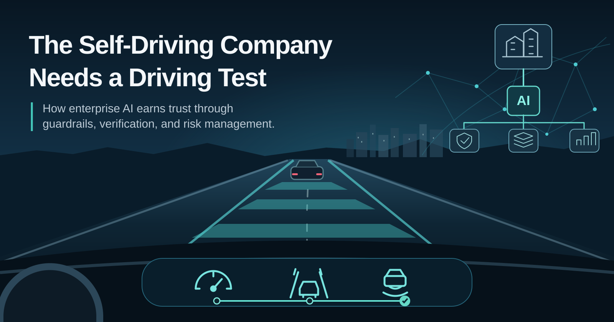

Replit CEO Amjad Masad recently [predicted that every Fortune 500 company will be a self-driving company by 2030](https://replit.com/blog/rise-of-self-driving-company). In his vision, people set direction and remain accountable while AI agents handle more of the execution.

I can see where he's going with this. I also think the driving analogy is worth taking a little further.

Cars didn't go straight from a steering wheel and pedals to driving themselves. We got cruise control. Set a speed and the car maintains it, while you remain responsible for the road. Adaptive cruise control can manage following distance. Lane-keeping assist helps with steering. Systems like Subaru's EyeSight can apply the brakes when a collision looks likely.

These features aren't one tidy progression toward autonomy. Emergency braking has a different job than cruise control. Some features help the driver perform a task. Others are there to reduce the consequences of a mistake. All of them have limitations.

That's what makes the analogy useful for enterprise AI.

## Start with cruise control

A scheduled script is a little like cruise control. You give it a specific job under reasonably predictable conditions. It repeats that work without needing your constant input.

An AI copilot is closer to lane assist. It can help make progress, catch some mistakes, and suggest corrections. You're still supervising, and you can take over.

Now we're asking agents to navigate longer stretches of work. They can interpret requests, choose tools, call other systems, and make decisions along the way. That's exciting. It also means they can misunderstand the destination and execute the wrong plan very efficiently.

The question isn't whether an agent is smart enough to complete a task once. It's whether we understand the conditions under which we can trust it to do that work repeatedly.

## Where are the brakes?

Replit makes a good case for an *Agent Habitat* with controlled access, human approvals, and security that scales with autonomy. I agree with that direction. The hard part is putting it into practice, workflow by workflow, inside organizations with existing systems and responsibilities.

Imagine an agent that drafts a report for review. If it gets something wrong, a person has a chance to catch it before the report goes anywhere.

Now imagine the same agent can update production records or send messages outside the organization. A similar mistake has very different consequences.

Those tasks deserve different safeguards.

One workflow might only require human review. Another might need restricted permissions, input validation, automatic tests, an execution log, and a way to undo changes. Some decisions should stay with people regardless of how capable the model becomes.

I've been thinking about this while working on ways to package tasks for AI agents. Instructions are useful, but telling an agent to check its work isn't the same as having a check that actually runs. I want to know what it did, what evidence it produced, and whether the result meets the conditions I set.

Automatic emergency braking doesn't work because the driver's manual says to avoid collisions. There's a separate mechanism designed to recognize a dangerous condition and intervene.

Enterprise agents need the equivalent.

## Leadership has to make room for trust

This is a risk-management problem, and enterprise leadership has a big role to play.

A blanket refusal to let agents act independently makes it difficult to learn what they can reliably do. Handing them broad access after a convincing demo is a gamble. There's a practical middle ground, but someone has to make room for it.

Start with a low-risk workflow. Define success and assign ownership. Give the agent only the access it needs. Review what actually happened, including mistakes and the time spent checking or correcting its output. If it performs reliably, consider expanding its scope.

A useful progression could look like this:

1. An agent reads information and prepares an answer.
2. It proposes a change, but a person approves the action.
3. It makes limited, reversible changes on its own, with checks and an audit trail.
4. Its authority grows only where the results and the consequences of failure justify it.

This isn't a universal maturity ladder. Different workflows call for different levels of oversight. A draft meeting summary and a change to a production system shouldn't face identical requirements.

Risk management has to account for the risk of doing nothing, too. People lose time to repetitive work. Useful ideas stay on the backlog. Organizations miss opportunities to learn how these systems behave in their own environments.

Reasonable safeguards make experimentation possible. They also give leadership something more useful than enthusiasm or fear: evidence.

## The work above the work

There's another obstacle I think gets overlooked. Plenty of business processes aren't actually documented in a way an agent could follow.

The steps might live in someone's head. There are exceptions everyone on the team understands but nobody has written down. Approval rules might depend on context that never makes it into a ticket.

As agents make execution cheaper, describing the work becomes more important. What is the actual goal? Which information is authoritative? What can be changed? What conditions should make the system stop and ask for help?

People closest to the work need to help answer those questions. And somebody needs to maintain those answers as systems, policies, and expectations change.

The organization has to learn how to delegate. That's work, too.

## Earn the next mile

I don't know whether every Fortune 500 company will be self-driving by 2030. I do think we'll delegate more work to agents, and organizations will need to get much better at deciding what that delegation should look like.

Cruise control is useful even if the car never drives itself. So is lane assist. So is emergency braking.

The self-driving company can develop the same way: useful capabilities, clear limitations, dependable safeguards, and more responsibility as trust is earned.

Brakes are part of what makes it possible to drive.

---

*This was prompted by [Amjad Masad's “The Rise of the Self-Driving Company”](https://replit.com/blog/rise-of-self-driving-company). Replit's article already recognizes the need for permissions, approvals, and governance. I'm especially interested in how enterprise leaders can make that progression practical.*
